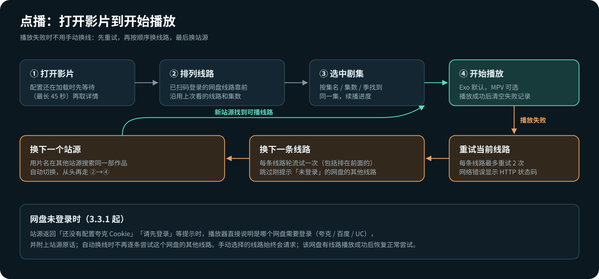
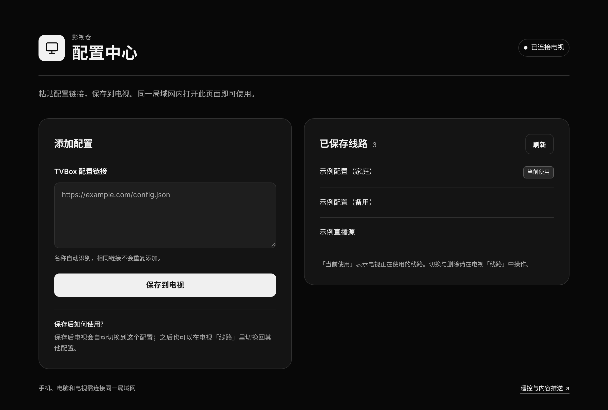
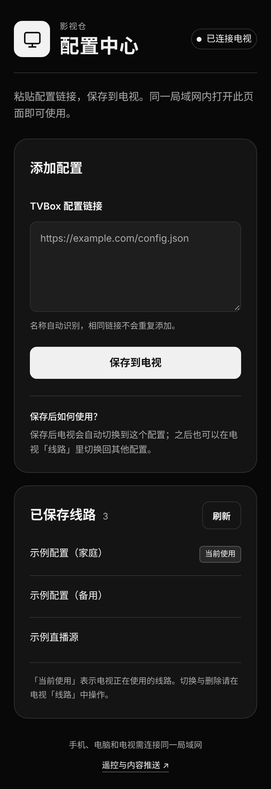
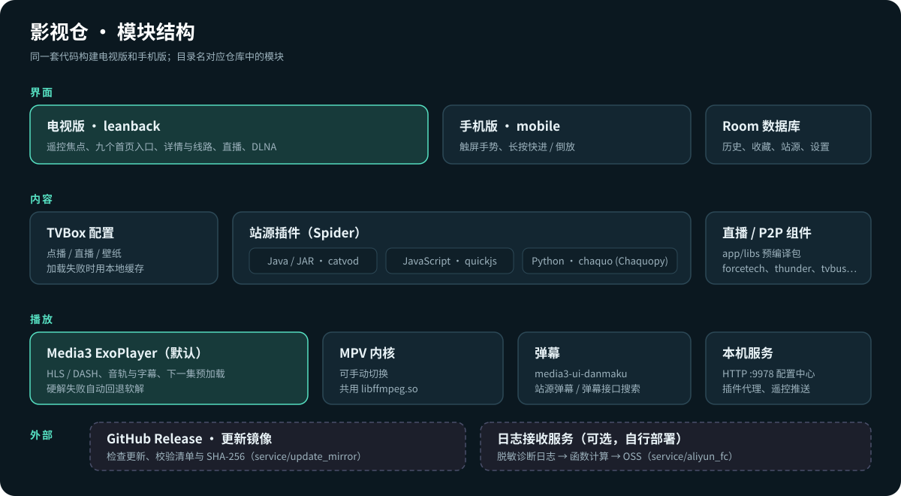

<p align="center">
  
</p>

<p align="center">
  <a href="https://github.com/LuckyWDGS/YingShiCang/releases/latest"></a>
  <a href="https://github.com/LuckyWDGS/YingShiCang/releases"></a>
  
  <a href="LICENSE.md"></a>
</p>

面向电视和盒子遥控操作的 Android 影视播放器。兼容 TVBox 配置，内置点播、直播、投屏和局域网配置；源码同时包含适合触屏的手机版界面。

**[⬇ 下载最新版](https://github.com/LuckyWDGS/YingShiCang/releases/latest)**

## 最近更新

**3.3.1**
- 网盘没有登录时，播放器直接说明是哪个网盘需要登录（夸克 / 百度 / UC），并附上站源的原话，不再只显示“正在切换线路”；自动换线时跳过这个网盘的其他线路，更快找到能播的线路。
- 闪退排查：记录闪退前所在的界面和正在执行的插件调用，下次启动写入诊断日志。
- 诊断日志更准确：区分 Exo / MPV 播放错误，进程退出只记一次，播放器自行恢复的错误不再算作失败。

**3.3.0**
- 没有保存过音轨选择时，默认选用第一条可用音轨。
- 短剧站源（AiDj）在没有改过预加载设置时，默认预加载下一集。
- 首页两行导航分别循环，宽屏卡片标题完整显示。
- 首页不会再被后台追剧检查中的插件调用意外关闭。

完整更新说明见各版本的 [Release](https://github.com/LuckyWDGS/YingShiCang/releases) 正文。

## 下载与安装

| 安装包 | 适用设备 |
| --- | --- |
| `YingShiCang-<版本>-tv-arm64-v8a.apk` | 大多数电视、盒子（64 位） |
| `YingShiCang-<版本>-tv-armeabi-v7a.apk` | 较老的 32 位电视、盒子 |

- 最低 Android 7.0（API 24）。不确定选哪个时先装 `arm64-v8a`，提示无法安装再换 `armeabi-v7a`。
- Release 提供电视版安装包，手机、平板也可以直接安装使用；手机版界面（`mobile`）目前需要从源码构建。
- 新版本可直接覆盖安装，站源、历史、收藏和网盘登录状态都会保留。
- 应用启动时从本仓库的最新 Release 检查更新，下载后校验版本、大小、SHA-256 和签名，再交给系统安装。

## 主要功能

**首页与发现**
- 九个一级入口：主页、热播电影、热播剧集、热播综艺、电影筛选、电视筛选、电影榜单、电视剧榜单、短剧漫剧。
- 观看历史直接排在首页网格里，用遥控器上下翻看；从播放页返回时焦点回到刚看的那张卡片。
- 电影、电视筛选会查询当前配置里的全部站源，按站源实际声明的分类和筛选项展示，失败的站源可单独重试。
- 短剧漫剧独立分类，支持 AI 漫剧、AI 短剧及站源声明的细分题材和“最新”排序。
- **追剧提醒**：定期检查收藏和最近 30 天看过的剧集，有新集数时在卡片上标记“有更新”并在首页提示（设置 → 追剧提醒）。

**搜索与详情**
- 多站源聚合搜索，结果按相关度排序，分页逐步加载；输入时实时联想。
- 支持拼音首字母搜索，例如输入 `xcjc` 会同时搜索“乡村警察”等候选片名。
- 从卡片进入时自动按片名和年份匹配同一部作品，排除无关结果。
- 详情页固定预览、信息、线路区，剧集网格独立滚动；长文件名在获得焦点时滚动显示。
- 电视版自动选用站源提供的最高清晰度；明确失效的资源会被暂时过滤，连续失败的站源会暂停 30 分钟再试。

**播放**
- 默认 Exo / Media3 内核，可手动切换 MPV；硬解失败时自动回退软解。
- 播放失败时自动重试、换线路，最后换站源；已扫码登录的网盘线路优先，沿用上次看的线路和集数。
- 全屏控制条常用入口：字幕、弹幕、音轨、画面比例，其余功能在“更多”菜单。字幕默认自动显示。
- 弹幕开启后切换剧集会自动加载，加载失败时自动重试。
- 触屏设备上长按画面右侧快进、左侧倒放。
- 播放错误以中文提示，网络错误显示具体的 HTTP 状态码。

<p align="center"></p>

**网盘**
- 设置 → 网盘登录 显示夸克、百度、UC 的状态：已扫码、未扫码或可能已失效。
- 线路标签上，已扫码登录的网盘会显示 ✓。

**直播**
- 频道分组、节目单（EPG）、数字键直接换台。
- 线路失败时自动依次尝试其他线路；遥控器左右键切换线路。

**投屏与局域网配置**
- 内置 DLNA 接收端，可从手机投屏到电视。
- 局域网配置：电视显示二维码，手机或电脑打开同一地址即可添加 TVBox 配置，无需配对码。保存后电视自动切换到新配置。

<p align="center">
  
  &nbsp;
  
</p>
<p align="center"><sub>局域网配置中心在电脑和手机浏览器中的样子（示例数据）</sub></p>

**诊断**
- 设置 → 日志上传与诊断 可上传脱敏的运行日志，不含账号、Cookie、播放地址和片名，便于排查问题（需自行部署接收服务，见[部署说明](docs/日志上传-阿里云OSS部署.md)）。

## 构建

<p align="center"></p>

| 目录 | 内容 |
| --- | --- |
| `app` | 应用本体；`leanback` 为电视版，`mobile` 为手机版，`main` 为共用代码 |
| `catvod` / `quickjs` / `chaquo` | Java、JavaScript、Python 站源插件的运行环境 |
| `scripts` | 依赖准备、统一检查、模拟器验证、发版清单生成 |
| `service` | 日志接收服务和更新镜像（服务器端，可选） |
| `docs` | 构建、发版与部署文档 |

需要 JDK 21、Python 3.10 和 Android SDK（compileSdk 37）。首次构建前先准备 Media3 源码：

```bash
python scripts/prepare_media.py      # 下载并校验 Media3 1.11.1 源码和本项目补丁
python scripts/check.py              # JVM 测试、手机版编译和服务端测试
./gradlew :app:assembleLeanbackDebug # 电视版调试包
```

正式包需要配置签名。环境配置、模拟器验证、签名和 GitHub 发版流程见[构建说明](docs/build.md)；原生播放器（MPV / FFmpeg）的重编步骤见 [scripts/native/README.md](scripts/native/README.md)。

## 文档

- [构建说明](docs/build.md)：环境、测试、签名、发版与应用内更新
- [日志上传：阿里云 Function Compute + OSS 部署](docs/日志上传-阿里云OSS部署.md)
- [更新镜像部署](service/update_mirror/README.md)
- [原生播放器重编](scripts/native/README.md)

各版本的改动说明写在对应 [Release](https://github.com/LuckyWDGS/YingShiCang/releases) 的正文中。

## 致谢与许可

基于 [FongMi/TV](https://github.com/FongMi/TV) 和 [AndroidX Media3](https://github.com/androidx/media) 构建，遵循 [GPLv3 许可证](LICENSE.md)。`app/libs` 中的 forcetech、hook、jianpian、thunder、tvbus 预编译包源码见 [FongMi/TV](https://github.com/FongMi/TV) 同名目录。

本仓库不包含任何影视内容或站源地址；签名密钥、本机配置、测试输出和 APK 不纳入源码仓库。
